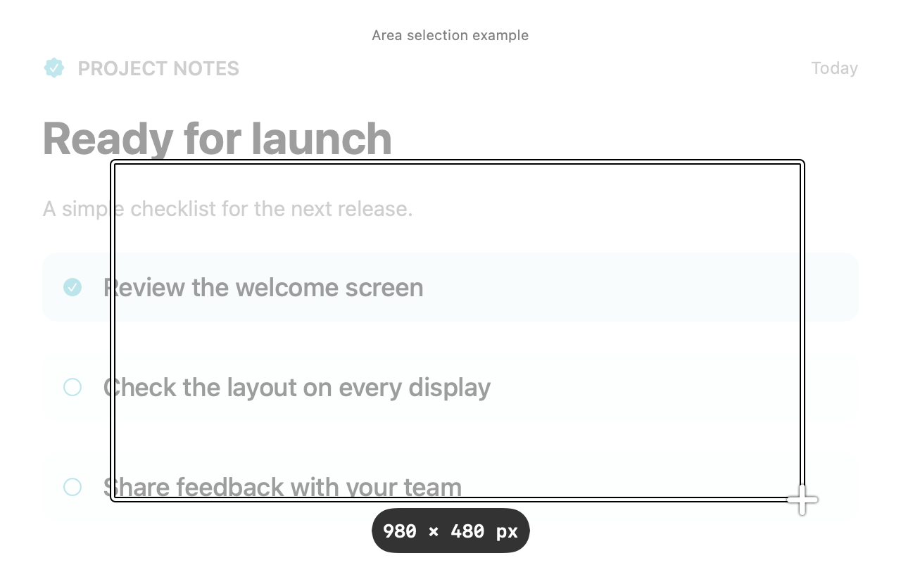
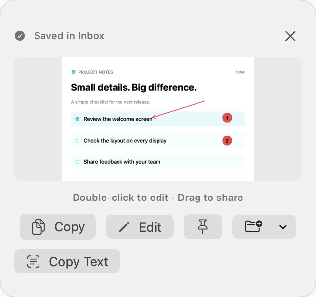
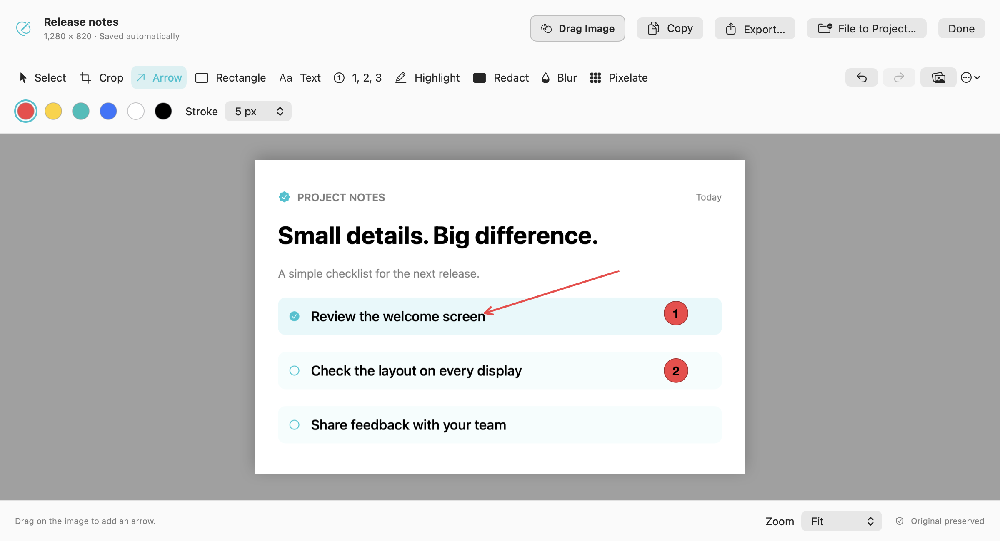
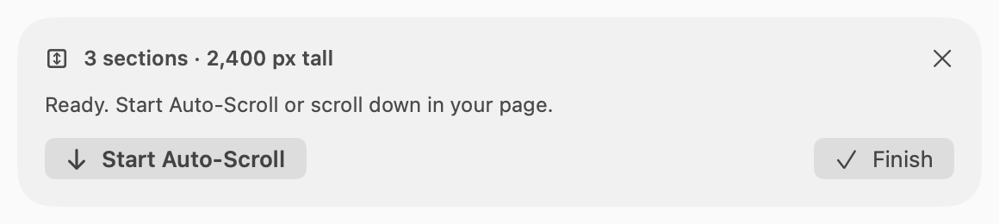
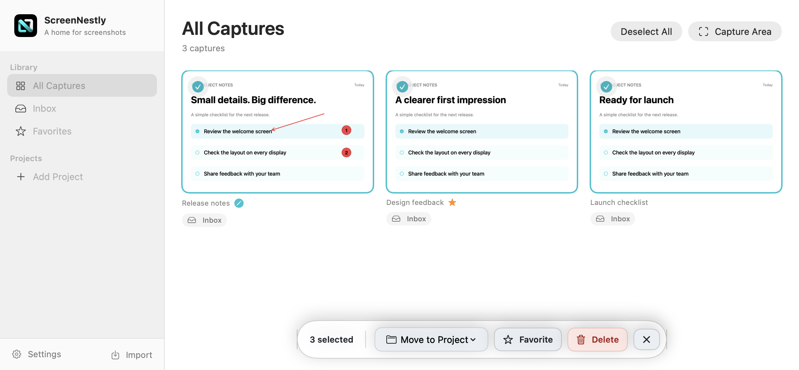

# Getting started with ScreenNestly

The first time you open ScreenNestly, a short guide walks you through setup. You can choose **Set Up Later** and reopen it anytime from **Help → Getting Started…**, including Help in the menu-bar dropdown.

## 1. Allow screen capture

1. In the guide, open **Permissions** and click **Allow Screen Capture**.
2. Open **System Settings → Privacy & Security → Screen & System Audio Recording**. Enable **ScreenNestly** and approve macOS’s prompt. If macOS asks you to quit and reopen, your guide step is remembered.
3. Return to ScreenNestly. The status changes to **Enabled**; **Check Again** refreshes it manually.

ScreenNestly captures still images and does not record audio. You can import images without screen-capture permission. macOS wording can vary; see [Apple’s permission guide](https://support.apple.com/guide/mac-help/mchld6aa7d23/mac).

Two permissions are optional:

- **Accessibility** allows Auto-Scroll to send scroll gestures. Enable it from the Permissions page when you want Auto-Scroll. Manual scrolling does not need it.
- **Folder access** lets Auto-Rules watch a folder. Use **Choose Folder…** to select it. ScreenNestly’s own captures already save in Inbox.

## 2. Take your first screenshot

1. Bring the window you want to capture to the front.
2. Press **⌘⇧2**, or click ScreenNestly’s viewfinder icon in the macOS menu bar and choose **Capture Area**. If you changed the shortcut, the app’s guide shows your current assignment.
3. Drag with the **+** cursor and release. Press **Escape** to cancel.

*Illustration of the selection rectangle and cursor.*

For an entire window or display, choose **Capture Window** or **Full Screen** from the menu-bar dropdown.

## 3. Share or edit

Your capture saves to Inbox and appears in a small corner preview.

- **Drag the thumbnail** to an app that accepts images or files.
- Click **Copy** to paste it elsewhere.
- Click **Edit**, or double-click the thumbnail, to annotate.
- Click **Pin** to keep a reference above other windows.

Closing the preview keeps your capture in the library.

Choose arrows, text, numbered steps, Blur, Pixelate, or Redact. Edits save automatically. To share the finished image, use **Copy** or drag **Drag Image** from the editor header. Both include your saved markups. Use solid **Redact** for information that must be completely hidden.

## 4. Capture a scrolling page

1. Bring your page or document to the front. Choose **Scrolling Capture** from the menu-bar dropdown.
2. Select the moving content below fixed headers and toolbars. Corner brackets show what will be captured.
3. Click **Start Auto-Scroll**, or scroll slowly downward yourself. Keep the selected window uncovered and watch the section count grow.
4. Click **Finish**. In the saved preview, use **Fit Width** and scroll to read the long image.

If no new section appears, check that the page is moving inside the selected area. If capture pauses because it cannot match an overlap, scroll back slowly toward the last captured section and pause. Auto-Scroll needs Accessibility access; check **Help → Permissions…**. Before a second section is captured, **Save One Image** saves a normal screenshot.

## 5. Keep your library organized

- **Inbox** contains captures that have not been filed to a project. **All Captures** includes every capture, including project items.
- Hover over a thumbnail and click its check circle, or press **⌘A** while the gallery has focus. Use the floating bar to **Move to Project**, **Favorite**, or **Delete**.
- **Delete** moves library files to macOS Trash. Existing project exports remain in their folders.
- Use **Import** for one or several images. In the picker, Command-click or Shift-click to select multiple files.
- **Add Project** connects a folder. Set up automatic organization in **Settings → Auto-Rules**.

Open Settings with **⌘,** to change appearance, capture shortcuts, or Quick Overlay behavior. The guide remains available through **Help** whenever you need it.

*App screenshots use sample content. Light and dark versions are bundled in the app; the permission-page visual is a labeled illustration.*
